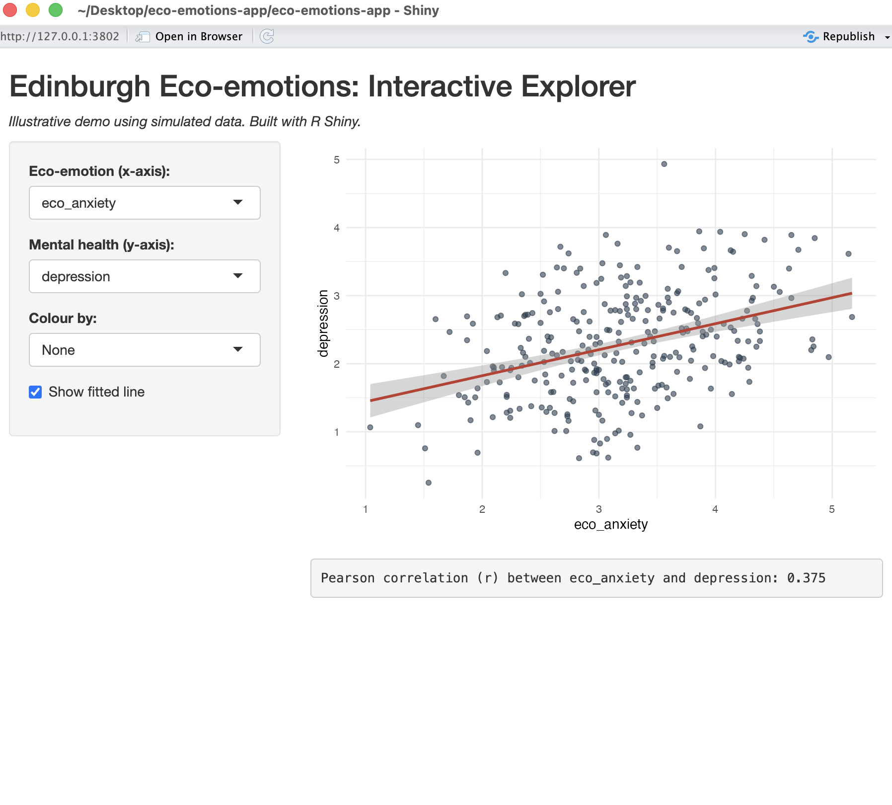

# Eco-emotions Interactive Explorer

An interactive web application built in **R Shiny** for exploring
relationships between eco-emotions (eco-anxiety, eco-anger) and
mental-health outcomes (depression, anxiety, stress).

Users can select variables, colour points by country, toggle a fitted
regression line, and view live correlation coefficients.

*Note: this demo uses simulated data for illustration; no participant
data is included.*

## Built with
- R Shiny (UI + reactive server logic)
- ggplot2 for interactive visualisation

# eco-emotions-app
